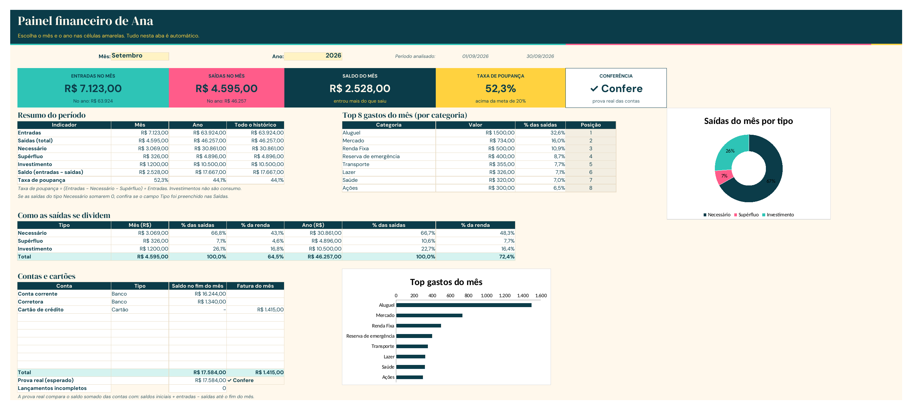
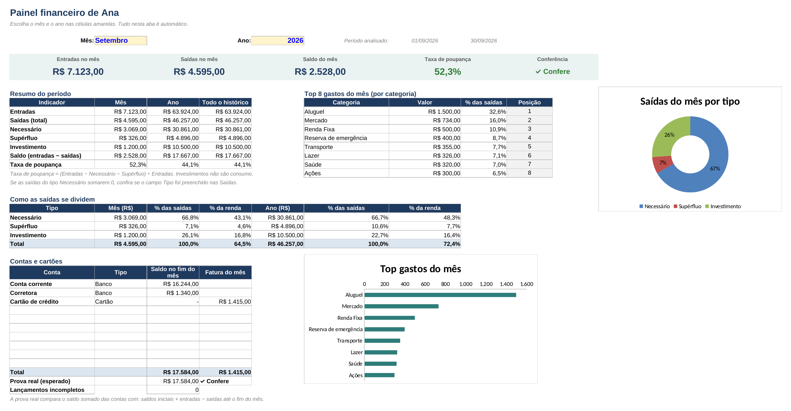

# Planejamento Financeiro Pessoal

Planilha em Excel e painel visual para organizar as finanças pessoais, disponíveis **com a consultoria de planejamento financeiro**.

## O que a planilha organiza

- Entradas, saídas e transferências entre contas
- Compras parceladas
- Categorias de gastos
- Evolução mês a mês no ano
- Reserva de emergência e metas
- Carteira de investimentos

## Painel visual

O painel transforma a planilha em uma visão simples: saldo do mês, entradas, saídas, taxa de poupança, maiores gastos por categoria, evolução no ano, reserva de emergência e meta de investimento.

A planilha é lida no próprio navegador: os dados não são enviados para a internet.

Veja uma demonstração com dados fictícios: https://bialehmanns-gif.github.io/painel-financeiro/

## Temas disponíveis

| Clássico | Essencial | Tropical |
|---|---|---|
|  |  |  |

## Como ter acesso

A planilha e o painel são entregues como parte da consultoria, com acompanhamento para configurar categorias, metas e investimentos de acordo com a sua realidade.

**Contato:** [PREENCHER: e-mail, LinkedIn ou WhatsApp]

---
© Todos os direitos reservados. As imagens deste repositório usam dados fictícios.
